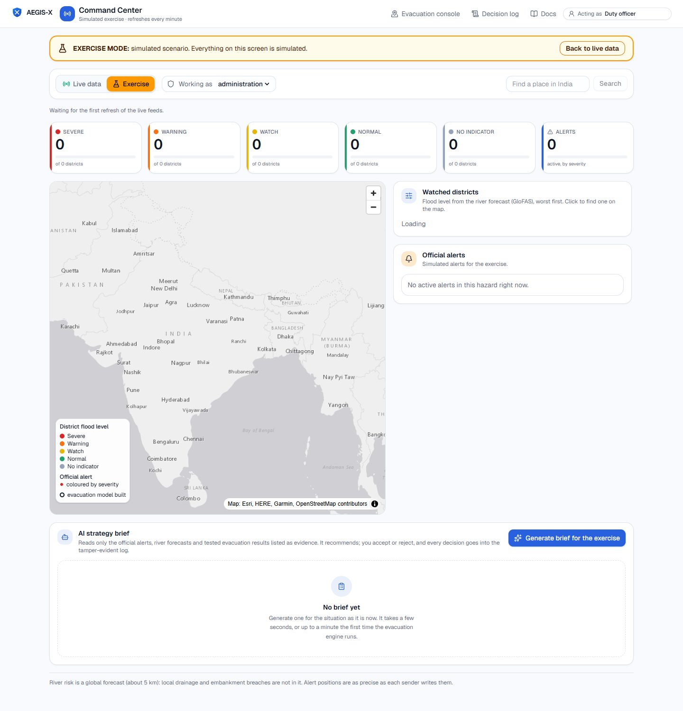
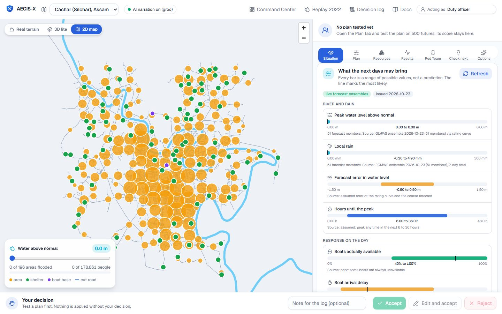
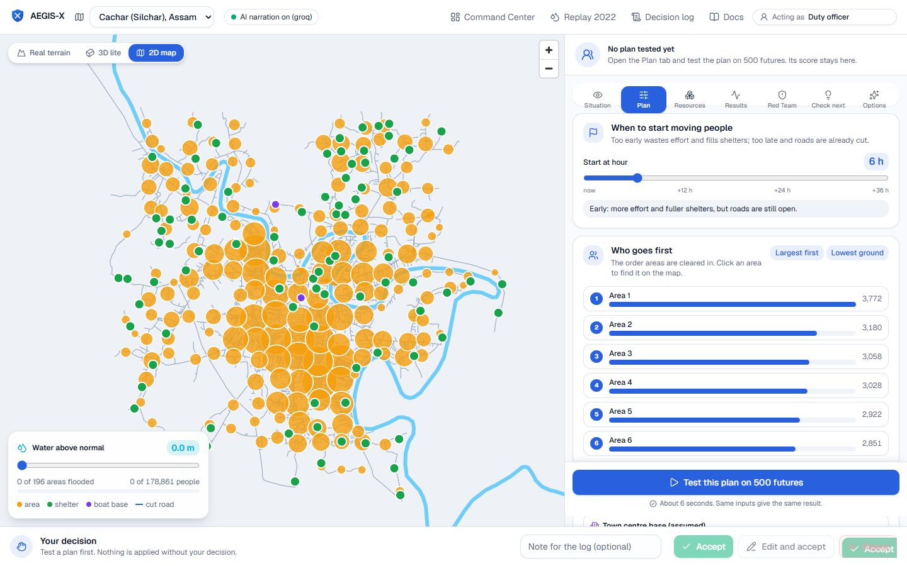
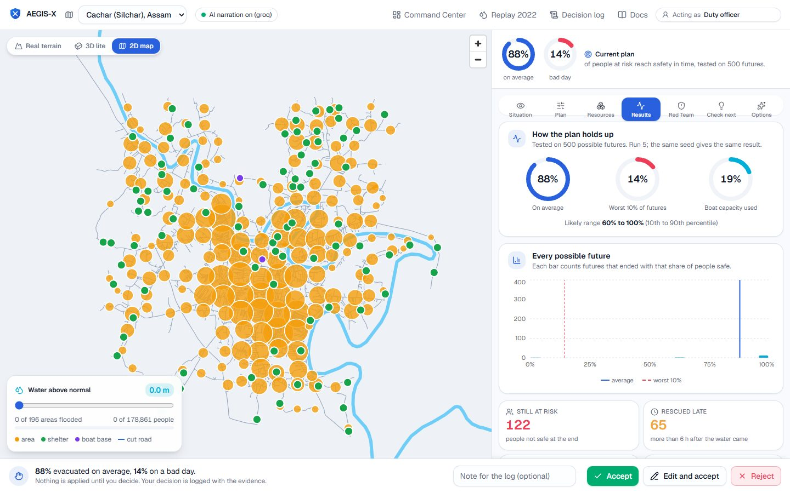
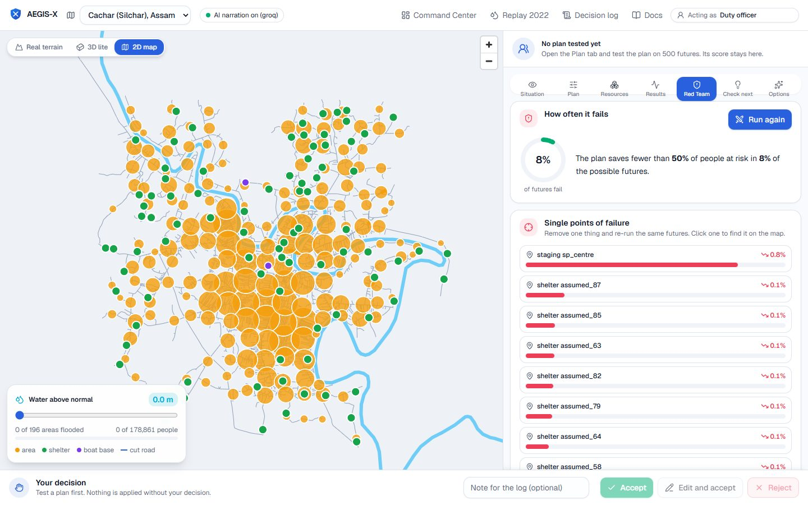
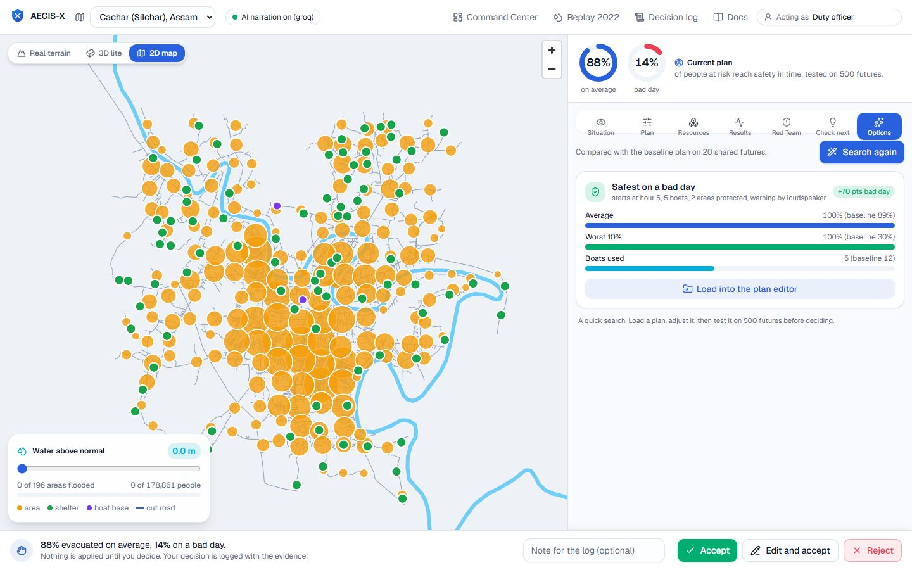
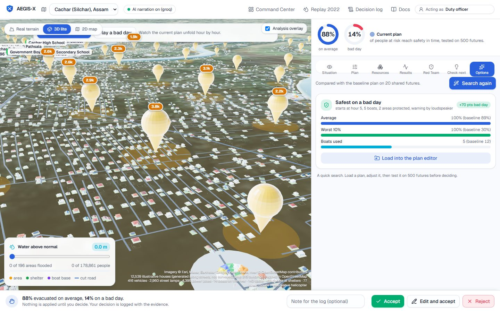
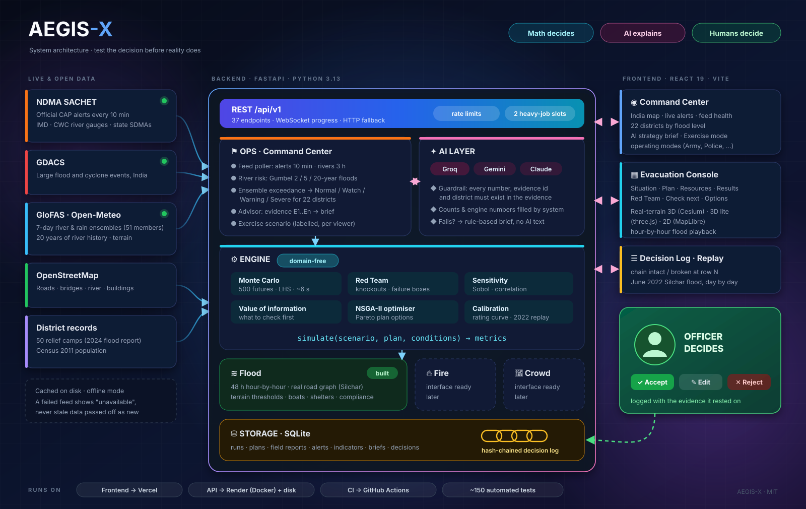
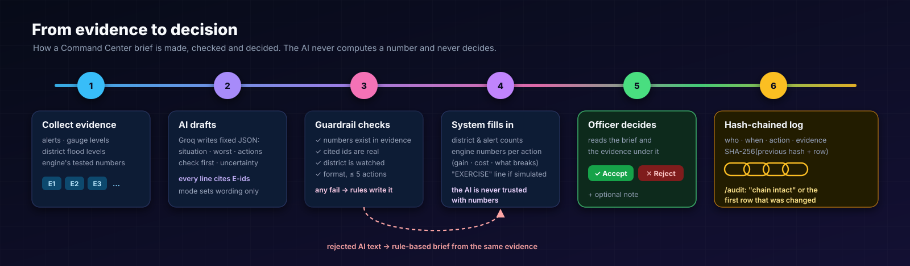
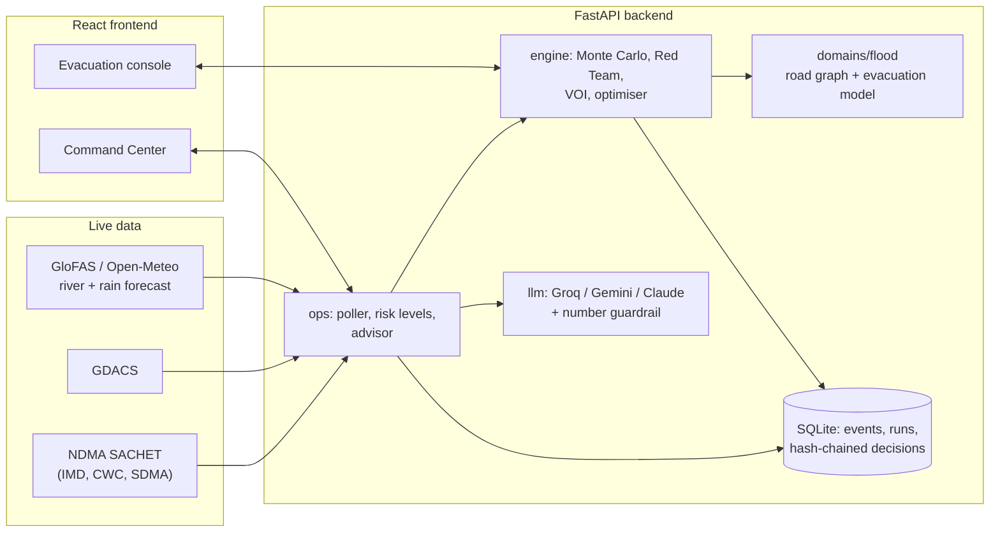

<div align="center">

# AEGIS-X

**Test the decision before reality does.**

A decision-support platform for flood evacuation. It runs a plan through hundreds of possible futures, tries to break it, tells you what to check first, and watches live official alerts. The math decides, the AI explains, a human decides.




</div>

---

## Contents

- [What is this?](#what-is-this)
- [Screenshots](#screenshots)
- [Features](#features)
- [How it works](#how-it-works)
- [Quickstart](#quickstart)
- [Configuration](#configuration)
- [Data sources](#data-sources)
- [Project layout](#project-layout)
- [API](#api)
- [Tests](#tests)
- [Deploy](#deploy)
- [Documentation](#documentation)
- [Honest limitations](#honest-limitations)
- [Contributing, security, license](#contributing-security-license)

## What is this?

When a river rises, an officer has to decide **who moves first, where to, with which boats, and when**. Those choices are made under uncertainty: the rain may be heavier, the bridge may fail, fewer boats may turn up, and people may not obey.

AEGIS-X does not predict one outcome. For a plan it:

1. **Simulates hundreds of futures** (rain, river level, bridge failures, boats, how many people obey) on a real road network.
2. **Red-Teams the plan**: finds the single bridge, shelter or boat base whose loss breaks it, and the smallest change that makes it fail.
3. **Ranks what to check first** (value of information), so scarce time goes to the check that changes the decision.
4. **Suggests better plans** (multi-objective search) and compares plans on the *same* futures.
5. **Watches live official alerts** (NDMA SACHET: IMD, CWC river gauges, state SDMAs) and river-flood forecasts for 22 flood-prone districts.
6. **Writes a briefing** with an AI model that may only use the evidence it is given. Every number is checked against that evidence, and the system falls back to plain rules if the AI is wrong.

> **The human always decides.** Nothing is sent or ordered. Every decision is stored in a tamper-evident log together with the evidence it rested on.

The built district is **Silchar / Cachar, Assam** (real OpenStreetMap roads and bridges, GloFAS river data, 50 relief camps from the district's own flood report). The engine itself is domain-agnostic: fire and crowd-safety modules are planned.

## Screenshots

<table>
  <tr>
    <td width="50%"><br><sub><b>Situation:</b> forecast ranges, data sources, what-if sliders, field reports</sub></td>
    <td width="50%"><br><sub><b>Plan:</b> start time, order of areas, boats, shelters, warning channels</sub></td>
  </tr>
  <tr>
    <td><br><sub><b>Results:</b> average vs bad day across 500 futures</sub></td>
    <td><br><sub><b>Red Team:</b> how often the plan fails and what breaks it</sub></td>
  </tr>
  <tr>
    <td><br><sub><b>Options:</b> optimiser-suggested plans against the baseline</sub></td>
    <td><br><sub><b>3D district view</b> with a play-through of the flood, hour by hour</sub></td>
  </tr>
</table>

## Features

| Area | What you get |
|---|---|
| **Engine** | Monte Carlo (Latin hypercube), Red Team (failure boxes, adversarial search, knockouts), Sobol sensitivity, value of information, NSGA-II optimiser, calibration. No domain code inside. |
| **Flood model** | Time-stepped 48 h evacuation on a real road graph: flood thresholds from terrain, rating curve calibrated on 16 years of river data, boats, shelter capacity, compliance, bridge failure. |
| **Evacuation console** | Seven tabs (Situation, Plan, Resources, Results, Red Team, Check next, Options) with an infographic sidebar and 3 map views (real terrain with Cesium, 3D lite with three.js, 2D MapLibre). |
| **Command Center** | India map, live official alerts, flood level per district, feed health, AI strategy brief with Accept / Reject, operating modes (Administration, Disaster Response, Armed Forces, Police, ...). |
| **Exercise mode** | A clearly labelled simulated flood for drills and demos. Per viewer, never mixed with live data. |
| **AI, with guardrails** | Narration and briefs from Groq (or Gemini / Claude). Numbers and ids are verified against the evidence; otherwise a rule-based text is used. |
| **Audit log** | Each decision is hash-chained to the previous one, stored with its evidence. `/audit` shows "chain intact" or the first broken row. |
| **Field reports** | Free-text reports ("Main bridge is under water") update bridge and resource beliefs (Bayesian). |
| **Replay** | June 2022 Silchar flood replayed day by day against what the model would have advised. |

## How it works

<p align="center"></p>

<p align="center"></p>

The full tour, with diagrams of every layer, the engine, the flood model, the live data pipeline, the AI guardrail and the data model, is in **[docs/architecture.md](docs/architecture.md)**.

<details>
<summary>Text version of the architecture (Mermaid)</summary>



</details>

**The one rule that keeps it honest:** every domain plugs into the engine through a single function,

```python
simulate(scenario, plan, conditions) -> metrics
```

and nothing in `backend/aegis/engine` imports anything from `domains/` (a test enforces it). The AI never computes or decides: it only phrases results that the engine already produced.

## Quickstart

You need **Python 3.12+** and **Node 20+**.

```bash
git clone https://github.com/ayushkumartht/AEGIS-X.git
cd AEGIS-X

# backend
python -m venv .venv
.venv/Scripts/pip install -r backend/requirements.txt pytest      # Linux/macOS: .venv/bin/pip
cp .env.example .env                                              # optional: add GROQ_API_KEY
cd backend && ../.venv/Scripts/python -m uvicorn aegis.api.main:app --port 8000 --reload

# frontend (second terminal)
cd frontend && npm install && npm run dev
```

On Windows you can start both with `./scripts/dev.ps1`. Then open:

| URL | What |
|---|---|
| http://localhost:5173/command | Command Center (try the **Exercise** switch if rivers are calm) |
| http://localhost:5173/console/cachar | Evacuation console for Silchar |
| http://localhost:5173/demo | Offline synthetic demo district |
| http://localhost:8000/docs | Interactive API docs |

The repository ships the built Silchar scenario and its cached source data, so it runs **without any API key and without a database setup**. Add a Groq key only if you want AI-written explanations and briefs.

## Configuration

Copy `.env.example` to `.env`. Everything is optional.

| Variable | Default | Purpose |
|---|---|---|
| `LLM_PROVIDER` | `groq` | `groq`, `gemini`, `claude` or `none` (templates only) |
| `GROQ_API_KEY` / `GEMINI_API_KEY` / `ANTHROPIC_API_KEY` | empty | Key for the chosen provider. Never commit it. |
| `LLM_MODEL` | provider default | Groq default is `openai/gpt-oss-120b`. Models are retired from time to time: list the current ones at `https://api.groq.com/openai/v1/models`. |
| `AEGIS_OPS_POLL` | `false` | Refresh live alerts (every 10 min) and river risk (every 3 h) in the background. Turn on in one process. |
| `AEGIS_OFFLINE` | `false` | Never call external APIs; use the cache only. |
| `AEGIS_DB_URL` | `data/aegis.db` | SQLite file (`sqlite:///...`). |
| `AEGIS_CORS_ORIGINS` / `AEGIS_CORS_ORIGIN_REGEX` | `http://localhost:5173` | Allowed browser origins. |
| `AEGIS_RATE_LIMIT_PER_MIN` / `AEGIS_MAX_HEAVY_JOBS` | `30` / `2` | Protection for the compute-heavy endpoints on a public site. |
| `VITE_API_URL` (frontend) | `http://localhost:8000` | Where the frontend finds the API. |

> **No accounts.** There is no login. The name typed in the header ("Acting as ...") is written into the decision log but is **not verified**. If you expose the app publicly, put it behind your own access control.

## Data sources

| Data | Source | Notes |
|---|---|---|
| Roads, bridges, river, buildings, shelters | OpenStreetMap (Overpass) | cached in `data/raw/` |
| Ground height | Open-Meteo elevation (Copernicus DEM, ~90 m) | |
| Rain and river forecast | Open-Meteo ensemble, GloFAS river discharge | 7-day ensemble, 16+ years of history |
| Official alerts, river gauges | NDMA SACHET (CAP feed from IMD, CWC, state SDMAs) | live |
| Large events | GDACS | live |
| Relief camps | Cachar district flood report 2024 (names), located via OpenStreetMap / Nominatim | capacities are **estimates** (2024 average 274 people per camp) |
| Population | Census 2011 total for Silchar (178,865) | spread over areas by road length: ward counts are not published |
| Boats and vehicles | not published | **assumed** (12 boats, 6 vehicles); replace with the district inventory |

Every input the screen shows is tagged **real data** or **estimate** (Situation tab, "Where this data comes from").

## Project layout

```
backend/aegis/
  engine/        domain-free core: Monte Carlo, Red Team, sensitivity, VOI, optimiser, calibration
  domains/       flood (built), fire and crowd (stubs behind the same interface)
  ops/           Command Center: SACHET and GDACS feeds, river risk, advisor, exercise scenario
  llm/           Groq / Gemini / Claude over HTTPS, prompts, number guardrail
  fusion/        field reports -> beliefs
  ingest/        OpenStreetMap, Open-Meteo, geocoding, shelter list, cache
  storage/       SQLite: runs, plans, reports, hash-chained decisions
  replay/        calibration and the 2022 replay
  api/           FastAPI app and routers
backend/tests/   pytest suite (engine, flood model, API, advisor, hash chain)
frontend/src/    React 19 + Vite + Tailwind: pages, features (map, plan, results, ops), viz kit
data/            district configs, reference data, built scenario, cached source data
scripts/         fetch_data, build_scenario, replay_event, geocode_relief_camps, dev.ps1
docs/            architecture, plans, research, images
```

Rebuild a district from scratch (needs network): `python scripts/fetch_data.py --district cachar`, then `python scripts/build_scenario.py --district cachar` and `python scripts/replay_event.py --event silchar_2022`.

## API

Base path `/api/v1`. Full reference: [docs/api-reference.md](docs/api-reference.md), live docs at `/docs`.

| Endpoint | What |
|---|---|
| `GET /districts/{d}/layers`, `/conditions` | map layers, uncertain inputs with sources |
| `POST /simulate`, `WS /ws/simulate` | Monte Carlo over a plan (the WebSocket streams progress) |
| `POST /analysis/redteam`, `/voi`, `/optimize`, `/compare` | the analyses |
| `POST /explain` | plain-language narration (AI or template) |
| `GET /ops/events`, `/ops/districts`, `/ops/feeds` | live alerts, district flood levels, feed health (add `?exercise=true` for the simulated scenario) |
| `POST /ops/brief`, `POST /ops/recommendations/{id}/decision` | AI strategy brief, accept / reject |
| `GET /decisions`, `GET /audit/integrity` | decision log and hash-chain check |

## Tests

```bash
cd backend && python -m pytest -q        # ~150 tests; the Cachar engine tests take a few minutes
cd frontend && npx tsc -b && npm run build
```

CI runs both, offline, plus a Docker build of the API image.

## Deploy

Frontend on **Vercel** (`frontend/vercel.json`), API on **Render** with Docker (`render.yaml`, `backend/Dockerfile`). The API needs a long-running process (simulations take seconds, WebSockets, a SQLite file), so it does not fit serverless functions. Step by step: [docs/fullstack-deployment-plan.md](docs/fullstack-deployment-plan.md).

## Documentation

Start at [docs/README.md](docs/README.md).

| Doc | What it answers |
|---|---|
| [architecture.md](docs/architecture.md) | How the pieces fit |
| [flood-decisions-uncertainty-data.md](docs/flood-decisions-uncertainty-data.md) | Which decisions, which uncertainties, which data (with tested sources) |
| [final-implementation-plan.md](docs/final-implementation-plan.md) | The master build plan |
| [command-center-plan.md](docs/command-center-plan.md) | Command Center design, feeds, advisor, exercise mode |
| [fullstack-deployment-plan.md](docs/fullstack-deployment-plan.md) | Going live |

## Honest limitations

- **Evacuation behaviour is assumed**, not measured: how many people obey, boat speed, shelter fill rate are sliders with sensible defaults. Only the river level is calibrated against a record.
- **Shelter capacities and boat numbers are estimates** until the district supplies them. 41 of the 50 relief camps are not on any map, so their position is assumed (on high ground) and labelled so.
- **River risk is a global forecast** (GloFAS, about 5 km). Local drainage and embankment breaches are not in it, and some small rivers are not resolved at all (those districts show "no indicator").
- **The AI can be wrong in ways a number check cannot see.** It only sees the evidence, every claim cites an evidence id, and the evidence is shown under each brief, but a human must read it.
- **Alert positions** are as precise as each sender writes them; some are whole districts or coded mandals and cannot be placed.
- **No accounts or access control.** The decision-log author is a typed name.
- Fire and crowd modules are interface stubs.

## Contributing, security, license

Contributions are welcome: see [CONTRIBUTING.md](CONTRIBUTING.md) and the [Code of Conduct](CODE_OF_CONDUCT.md). Report vulnerabilities as described in [SECURITY.md](SECURITY.md). Released under the [MIT License](LICENSE).

AEGIS-X is decision support for people trained to make these decisions. It is not an official warning system and must not replace one.
