# AEGIS-X architecture

<p align="center">
  
</p>

> **Math decides · AI explains · Humans decide.** Every number on screen comes from the simulation engine or an official feed. The language model only phrases what it is given, and a person accepts or rejects every recommendation.

**On this page:** [principles](#1-five-principles) · [system context](#2-system-context) · [backend layers](#3-backend-layers) · [the engine](#4-the-engine) · [the flood model](#5-the-flood-model) · [live data pipeline](#6-live-data-pipeline) · [AI brief and guardrail](#7-ai-brief-and-guardrail) · [decision log](#8-tamper-evident-decision-log) · [data model](#9-data-model) · [frontend](#10-frontend) · [deployment](#11-deployment) · [numbers](#12-numbers-that-matter) · [repo map](#13-repo-map)

---

## 1. Five principles

| # | Principle | Where it shows in the code |
|---|---|---|
| 1 | **The engine knows nothing about floods.** It calls one function and works for any hazard. | `backend/aegis/engine/` imports nothing from `domains/`; a test enforces it. |
| 2 | **Ranges, not predictions.** Every uncertain input is a distribution; every result is a spread with a bad-day figure. | `ConditionSpace`, Latin hypercube sampling, `resilience()` = mean of the worst 10%. |
| 3 | **Fair comparison.** Plans are compared on the *same* sampled futures, so a difference is the plan, not luck. | `compare_plans()` draws futures once. |
| 4 | **Never pass an estimate off as data.** Each input carries its source; estimates are labelled on screen; a failed feed says so. | `Variable.source`, Situation tab "Where this data comes from", `ops_feed` health. |
| 5 | **The AI is boxed in.** It sees only numbered evidence, must cite it, and every number, id and district is checked; otherwise rules write the text. | `aegis/ops/advisor.py`, `aegis/llm/explain.py`. |

## 2. System context

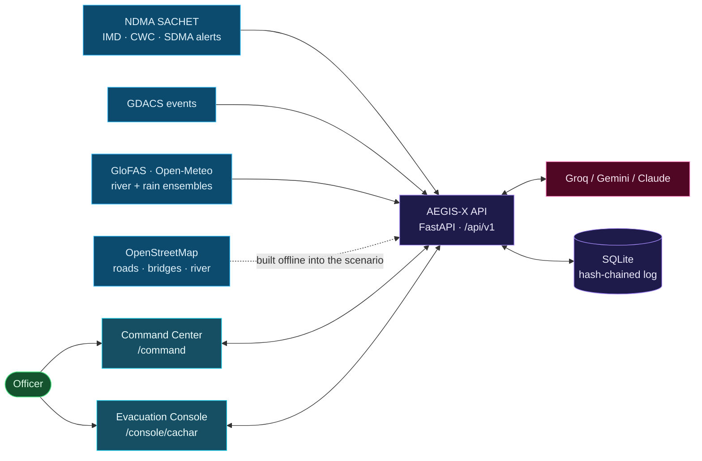

## 3. Backend layers

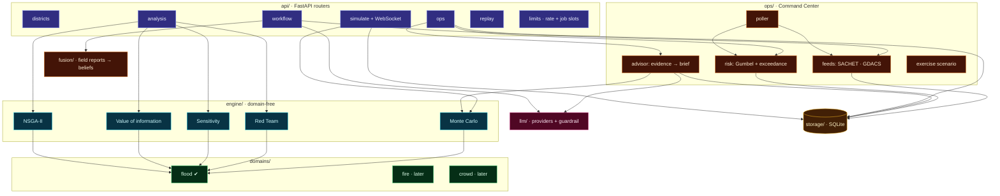

| Package | Responsibility |
|---|---|
| `api/` | Routers, request schemas, per-district context cache, rate limits and heavy-job slots, WebSocket streaming with an HTTP fallback. |
| `engine/` | Sampling, Monte Carlo, comparison, Red Team, sensitivity, value of information, optimiser, calibration. Pure numpy/scipy. |
| `domains/flood/` | The scenario (road graph + people + shelters), plan, conditions, the 48-hour evacuation model, plan codec for the optimiser. |
| `ops/` | Live feeds, river-risk levels, background poller, AI advisor, exercise scenario, hazard registry. |
| `llm/` | Groq, Gemini and Claude over plain HTTPS; prompts; the number guardrail; field-report parsing. |
| `fusion/` | Turns free-text field reports into Bayesian beliefs about bridges and resources. |
| `ingest/` | OpenStreetMap, Open-Meteo/GloFAS, geocoding, shelter CSV, file cache with offline mode. |
| `storage/` | SQLite tables and queries, including the hash-chained decision log. |
| `replay/` | Rating-curve calibration and the day-by-day replay of a past flood. |

## 4. The engine

Every domain implements one contract. The engine only ever calls these methods:

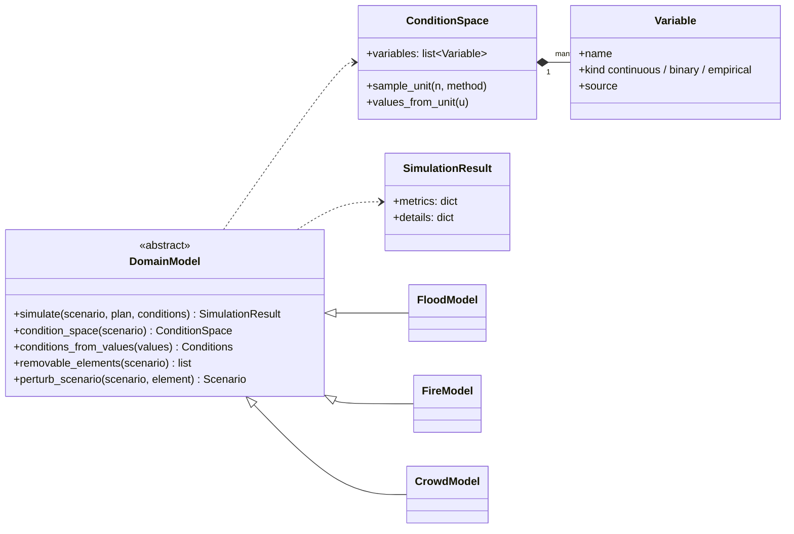

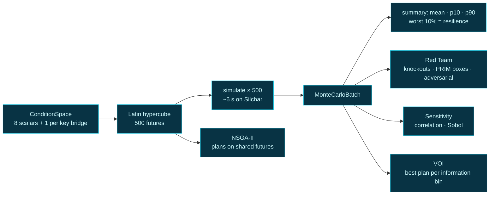

| Analysis | Question it answers | Method |
|---|---|---|
| Monte Carlo | How does the plan do across plausible futures, and on a bad day? | Latin hypercube over the condition space; resilience = mean of the worst 10%. |
| Compare | Is plan B really better than plan A? | Both on identical futures. |
| Red Team: knockouts | Which single bridge, shelter or boat base breaks the plan? | Remove one element, re-run the same futures, rank by the drop. |
| Red Team: failure boxes | Under which conditions does it fail? | PRIM-style box search over failing futures (density, coverage, support). |
| Red Team: adversarial | What is the smallest push that breaks it? | Search from a typical future towards the failure line. |
| Sensitivity | Which unknown moves the result most? | Correlation (fast) or Sobol indices (Saltelli/Jansen). |
| Value of information | What should we find out first? | Best candidate plan per bin of a variable vs the best plan without knowing it. |
| Optimiser | Which plans trade off safety, average and boats best? | NSGA-II on an encoded plan; labelled Pareto picks. |

## 5. The flood model

One future = one set of conditions, played hour by hour for 48 hours on the Silchar road graph.

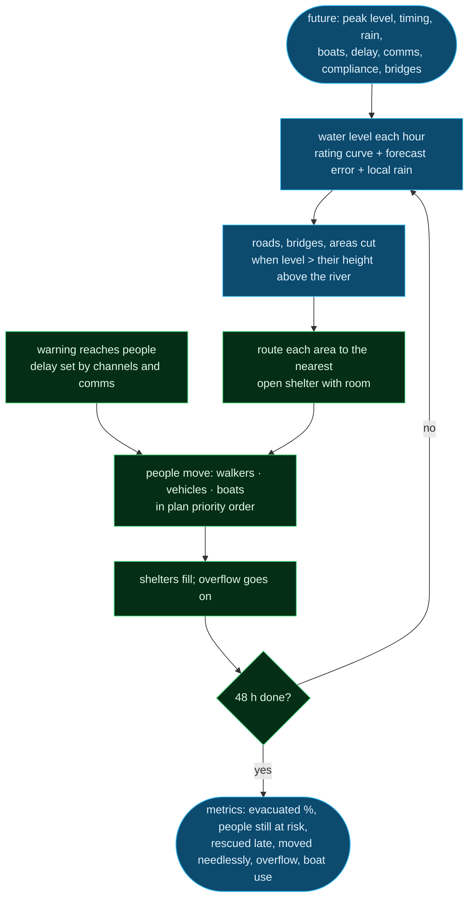

Details are in [domain-models.md](domain-models.md).

## 6. Live data pipeline

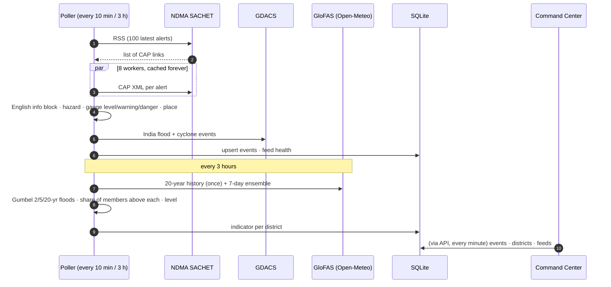

**District flood level** = which flood the forecast is likely to pass:

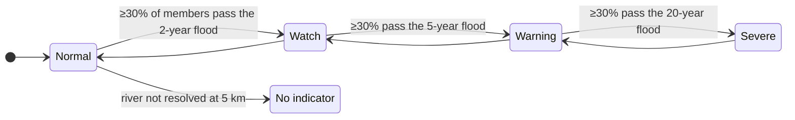

A feed that fails keeps its last data, labelled with its age; nothing is invented to fill the gap. **Exercise mode** swaps the live rows for a labelled simulated scenario, per request (`?exercise=true`), never stored and never mixed.

## 7. AI brief and guardrail

<p align="center">
  
</p>

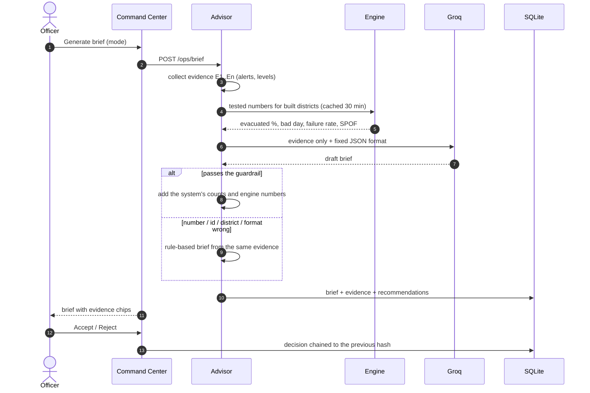

What the guardrail checks: every number in every sentence appears in the evidence (or in fixed definitions such as 2/5/20-year), every cited id exists, every action's district is a watched district, at most 5 actions and at most 5 items per section. Counts and engine numbers are never taken from the model.

## 8. Tamper-evident decision log

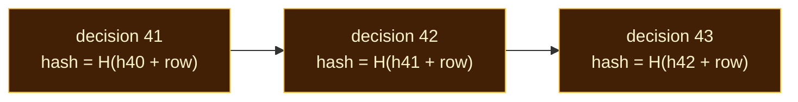

`/audit/integrity` recomputes every hash: an edited row, or a row removed from the middle, breaks the chain at that point. Older rows without a hash are counted as legacy. Limit, stated on screen: deleting the newest rows cannot be detected without an outside copy of the latest hash.

## 9. Data model

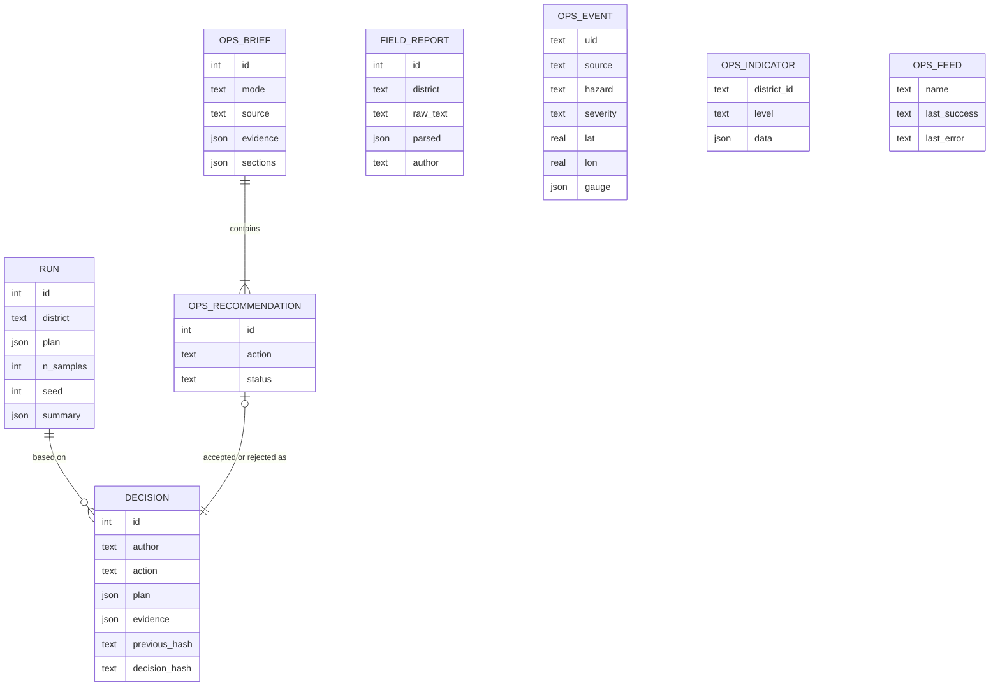

## 10. Frontend

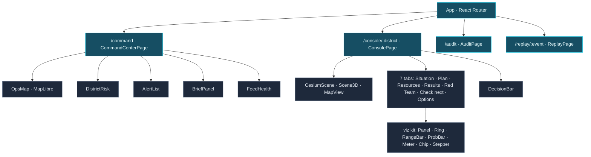

| Concern | Choice |
|---|---|
| Server state | TanStack Query (polling every minute on the Command Center) |
| Client state | Zustand (`consoleStore`, `operatorStore`) |
| Maps | MapLibre (2D), CesiumJS with Esri terrain/imagery (real 3D), three.js (3D lite with playback) |
| Charts | Recharts plus a small SVG kit (rings, range bars, meters) |
| Styling | Tailwind CSS v4 tokens: `flood`, `risk`, `safe`, `warn` |

## 11. Deployment

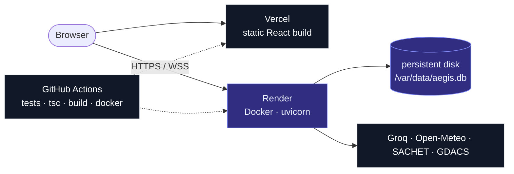

Why not serverless for the API: simulations take seconds of CPU, progress streams over a WebSocket, and the decision log needs a disk. Details: [fullstack-deployment-plan.md](fullstack-deployment-plan.md).

## 12. Numbers that matter

| What | Value |
|---|---|
| Silchar road graph | 6,655 nodes · 7,252 edges · 8 key bridges |
| People and places | 178,861 people in 196 areas · 90 shelters (50 relief camps) · 2 boat bases |
| One plan test | 500 futures in about 6 seconds |
| Red Team on Silchar | 2-5 minutes (one re-run per knockout element) |
| River calibration | 16 years of discharge; 2022 replay over 18 days |
| Watched districts | 22, across 8 states and union territories |
| Feed refresh | alerts every 10 minutes, river risk every 3 hours |
| AI brief | one model call; engine numbers cached 30 minutes |
| Tests | about 150 backend tests, plus type-check and build in CI |

## 13. Repo map

```
backend/aegis/
├── engine/      interfaces · sampling · montecarlo · compare · redteam · sensitivity · voi · optimizer · calibration
├── domains/
│   ├── flood/   types · builder · hydrology · evacuation · model · uncertainty · plans · geojson · serialize · checks · demo
│   ├── fire/    stub
│   └── crowd/   stub
├── ops/         feeds/{sachet,gdacs} · districts · risk · poller · advisor · exercise · hazards · store
├── llm/         base · groq/gemini/claude providers · prompts · explain (guardrail) · parse_report
├── fusion/      reports · beliefs
├── ingest/      osm · open_meteo · geocode · shelters · district · cache · http
├── storage/     db · repo (hash chain)
├── replay/      calibration + replay
└── api/         main · routers/{districts,simulate,analysis,workflow,ops,replay} · schemas · limits · services · context
frontend/src/
├── pages/       CommandCenter · Console · Audit · Replay · Landing · Documentation
├── features/    map · ops · situation · plan · results · redteam · check-next · options · decision
├── components/  viz/kit · ui · site
└── state/       consoleStore · operatorStore
```
