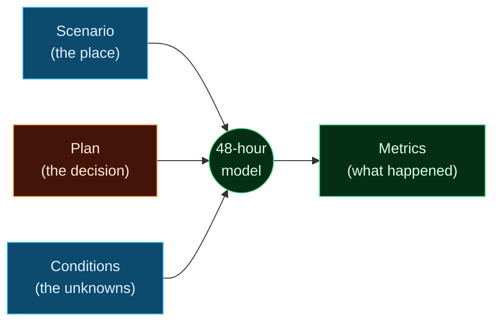
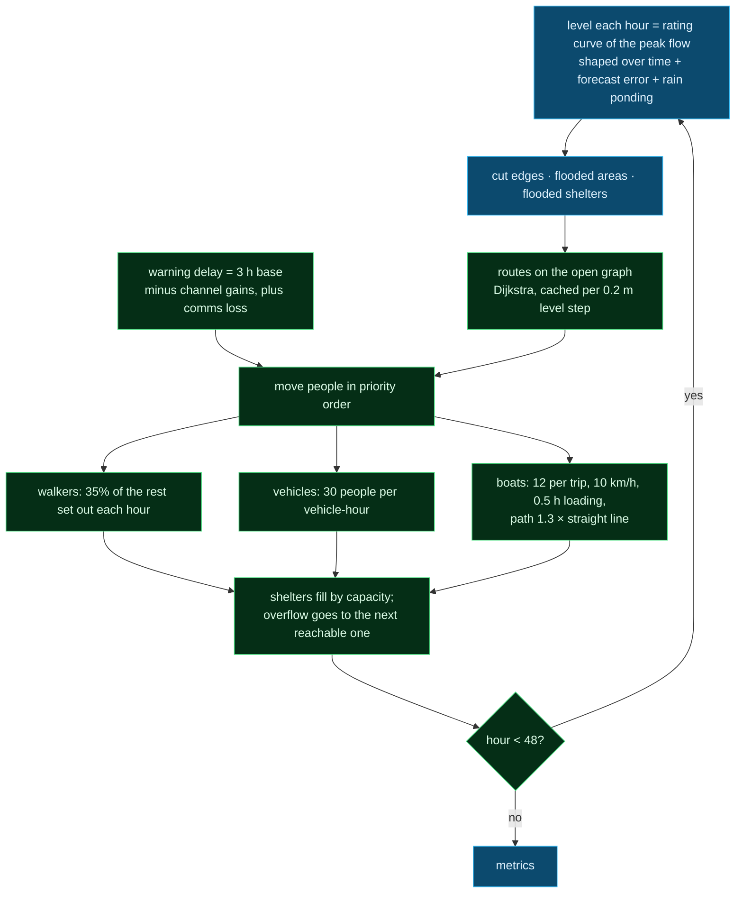

# Domain models

The engine is domain-free. A domain plugs in by implementing `DomainModel` (`backend/aegis/engine/interfaces.py`):

| Method | What the domain provides |
|---|---|
| `condition_space(scenario)` | the uncertain inputs, each with a range and a **source** |
| `simulate(scenario, plan, conditions)` | one future → `SimulationResult(metrics, details)` |
| `conditions_from_values(values)` | turn sampled numbers back into domain conditions |
| `removable_elements(scenario)` / `perturb_scenario(scenario, element)` | what the Red Team may knock out (bridges, shelters, boat bases) |

Status: **flood is built**; fire and crowd are stubs behind the same interface.

---

## Flood

### Scenario: the place

Built by `scripts/build_scenario.py` from OpenStreetMap, Open-Meteo elevation and the district config (`domains/flood/builder.py`).

| Part | How it is made | Silchar |
|---|---|---|
| Road graph | OSM roads; nodes at junctions, way ends and every ~100 m; largest connected part | 6,655 nodes, 7,252 edges |
| Height above the river (HAND) | ground elevation minus the river's normal level (25th percentile of the river's elevation) | per node, edge, area, shelter |
| Flood threshold | an edge floods at its lowest end; a bridge at its highest end + 2 m deck clearance | |
| Key bridges | longest bridges on trunk to tertiary roads (≥ 30 m), up to 8 | 8 |
| Areas (clusters) | 750 m cells; people spread by road length and scaled to the Census total; areas under 150 people dropped | 196 areas, 178,861 people |
| Shelters | district CSV (relief camps), OSM schools/colleges/halls, listed camps without a position placed on high ground, assumed assembly points until space covers half the people | 90 (50 relief camps) |
| Boat bases | district config | 2 (assumed positions) |

Everything that is an estimate carries a source string and is labelled on screen.

### Plan: the decision (D1-D7)

| | Field | Meaning |
|---|---|---|
| D1 | `start_hour` | when the order goes out |
| D2 | `priority` | which areas are cleared first |
| D3 | `open_shelters` | shelters in use |
| D4 | `route_avoid` | bridges kept free of evacuation traffic |
| D5 | `boats_at`, `vehicles_at` | where boats and vehicles start |
| D6 | `protected` | areas guarded or raised (flood ~1 m later) |
| D7 | `warning_channels` | siren, SMS, loudspeaker, door to door |

### Conditions: the unknowns

| Variable | Default range or source |
|---|---|
| `peak_stage_m` | GloFAS 51-member river ensemble through the calibrated rating curve |
| `stage_bias_m` | error of the rating curve and the coarse forecast (assumed −0.5 to 0.5 m) |
| `peak_time_h` | 6 to 36 h (assumed) |
| `local_rain_mm` | ECMWF ensemble, 2-day total |
| `boat_availability_pct` | 40-100% (some boats are always unavailable) |
| `boat_delay_h` | arrival delay of boats (assumed) |
| `comms_degradation_pct` | share of warnings lost |
| `compliance_pct` | share of people who obey the order |
| `bridge_open:<id>` | per key bridge: open or closed, updated by field reports (Bayesian) |

### The 48-hour model (`domains/flood/evacuation.py`)

Key constants (all in one place at the top of `evacuation.py`):

| Constant | Value | Meaning |
|---|---|---|
| `WALK_FRACTION_PER_H` | 0.35 | share of remaining walkers who set out each hour |
| `VEHICLE_CAPACITY_PER_H` | 30 | people one vehicle moves per hour |
| `BOAT_CAPACITY` | 12 | people per boat trip |
| `BOAT_SPEED_M_PER_H` | 10,000 | boat speed |
| `BASE_WARNING_DELAY_H` | 3 | hours for an order to reach people |
| `PROTECT_BONUS_M` | 1.0 | extra height for protected areas |
| `RESCUE_WINDOW_H` | 6 | after this, a rescue counts as late |
| `LATE_SHARE` | 0.6 | share of people who refused who later ask for rescue |
| `FALSE_ALARM_WEIGHT` | 0.3 | weight of needless moves in the decision score |
| warning channels | siren/SMS −10% delay; loudspeaker −10% and +2% compliance; door to door −25% and +8% compliance | |

### Metrics

| Metric | Meaning |
|---|---|
| `evacuated_pct` | share of people in areas that flood who reach safety in time (**the main score**) |
| `decision_score` | `evacuated_pct − 0.3 × needless moves / population` (used for value of information) |
| `people_at_risk_end` | people still in flooded areas at hour 48 |
| `rescued_late` | rescued more than 6 h after their area flooded |
| `unneeded_evacuations` | moved although their area never flooded |
| `shelter_overflow` | people with no shelter place |
| `boat_utilisation` | share of offered boat capacity used |
| `avg_evac_time_h`, `last_evac_time_h` | time to finish areas |
| `flooded_cluster_share`, `peak_level_m` | how big the flood was |

### Calibration (`replay/`)

The rating curve `stage = k · ln(Q / Q_normal)` is fitted on 16 years of GloFAS discharge: `Q_normal` is the median annual maximum (about the 2-year flood), and `k` is set so the record flow floods a stated share of people. The June 2022 flood is then replayed day by day (`/replay/silchar_2022`).

---

## Fire (planned)

Satellite fire detections (NASA FIRMS, needs a free key), wind and humidity (Open-Meteo), land use (OpenStreetMap); spread plus evacuation on the same road graph.

## Crowd safety (planned)

Venue and gate geometry (OpenStreetMap), event schedules, live counts from a partner; flow through gates and choke points. Intended for police and event organisers.
